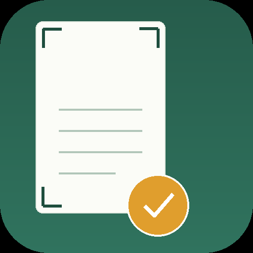
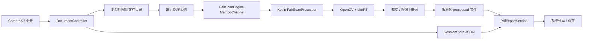

<p align="center">
  
</p>

<h1 align="center">作业扫描 · Homework Scanner</h1>

<p align="center">
  <b>连续拍照 → 自动裁切/增强 → 多页管理 → 一个 PDF</b><br>
  一个专注、离线、不折腾的 Android 作业扫描 App。
</p>

<p align="center">
  
  
  
  
</p>

<p align="center">
  <a href="https://github.com/Resemble-Cloud/homework-scanner/raw/release-apk/homework-scanner-v1.0.0-arm64.apk">
    
  </a>
</p>

---

## 这是什么

**作业扫描**是一个 Android 端的文档扫描 App，面向学生作业/笔记：

- 连续拍摄多页，后台逐页处理，不阻塞下一次快门；
- 自动检测纸面四角、透视校正、灰度/彩色/黑白增强；
- 支持重新裁剪、重拍、删除、拖动排序；
- 多份文档独立保存，随时继续上一份或新建下一份；
- 相册支持一次多选导入；
- 最后导出一个多页 PDF，可直接系统分享/保存。

所有图片和 PDF 都在本机处理，**不需要账号，不上传云端，不做 OCR**。

> 本项目是 MVP：主流程已经可用，算法和真机适配仍在持续打磨。

---

## 下载

当前版本 **v1.0.0**，arm64 安装包约 53 MB：

- [下载 homework-scanner-v1.0.0-arm64.apk](https://github.com/Resemble-Cloud/homework-scanner/raw/release-apk/homework-scanner-v1.0.0-arm64.apk)
- SHA-256：`cb63d10f4c01482bf882bc71bf2b0f0563d514ab8744e42c363d58b57287927e`

要求 Android 8.0（API 26）及以上，安装时允许“安装未知来源应用”。

> APK 暂放在 `release-apk` 分支；GitHub Actions/Releases 因账号 billing
> 限制暂不可用，后续恢复后会迁移到正式 Release。

---

## 功能

### 拍摄与导入

- 全屏 CameraX 相机，支持闪光灯、A4 参考框；
- 快门后立刻入队，处理在后台串行执行；
- 相册支持单张/多选导入，按选择顺序加入当前文档。

### 自动裁切

原生检测会返回三个候选：

| 候选 | 作用 |
| --- | --- |
| 检测框 | 最紧，优先去掉桌面 |
| 纸面外框 | 保留整页/整本，通常带少量桌面 |
| 整图 2% | 保底，只裁掉照片边缘 |

控制器会结合纸面覆盖率、取景占比和背景比例选择候选；不确定时显示“建议检查”，不静默切页。

页面详情里可以：

- 一键切换三个候选并重新处理；
- 进入四角编辑器手动拖动四个角；
- 切换自动/彩色/灰度/黑白；
- 开关保守去阴影。

### 多文档

启动进入“我的扫描”文档库：

- 每份文档独立目录、独立 `session.json`；
- 点击卡片继续编辑；
- “扫描新文档”创建下一份；
- 返回文档库自动刷新；
- App 被强杀/重装后，未完成页面可恢复。

### 设置

“我的扫描”右上角齿轮：

- 默认色彩：自动 / 彩色 / 灰度 / 黑白（默认灰度）
- 默认裁切：自动 / 检测框 / 纸面外框 / 整图 2%（默认自动）
- 设置只影响新页面，不回溯修改已有页面。

### PDF

- Dart `pdf` 逐页组装；
- 处理后的 JPEG 以原始 DCT 流嵌入，避免二次编码；
- 支持 A4 适配或原始比例；
- 默认文件名 `扫描_日期时间.pdf`，可改名；
- 通过系统分享/保存面板输出。

---

## 处理流程



几个关键约束：

- **严格串行**：一次只把一个页面送进原生引擎，避免 12MP 原图并发导致内存峰值；
- 原图永远保留，处理结果写新文件，失败不覆盖原图；
- 处理结果文件名带时间戳，避免 Flutter `ImageCache` 按路径缓存旧图；
- 原生编码前裁掉 2px 插值边缘，避免透视校正后的黑边。

---

## 技术栈

| 层 | 技术 |
| --- | --- |
| UI | Flutter 3.47 / Dart 3.13 / Material 3 |
| 相机 | `camera`（CameraX） |
| 相册 | `image_picker`（多选） |
| 原生引擎 | Kotlin + FairScan `imageprocessing` |
| CV / ML | OpenCV 4.12 + LiteRT 1.4.1 |
| PDF | Dart `pdf` + 原始 JPEG DCT 嵌入 |
| 存储 | 本地文件 + JSON（无数据库、无网络） |

Android：minSdk 26，targetSdk 36。

---

## 项目结构

```text
lib/
  main.dart                       # 依赖装配、设置加载
  models/
    scan_document.dart            # 文档/页面模型、JSON、四角
    scan_settings.dart            # 默认色彩/裁切
  services/
    document_controller.dart      # 串行队列、候选选择、恢复、导出
    session_store.dart            # 文档目录 + session.json
    settings_store.dart           # scan_settings.json
    pdf_export_service.dart       # 逐页 PDF
    share_service.dart            # 系统分享
  features/
    camera/                       # 全屏相机
    documents/                    # 文档库
    document/                     # 页面网格、详情、导出
    settings/                     # 扫描设置
  widgets/                        # 四角编辑器、缩略图
packages/fairscan_engine/         # Kotlin 原生 FairScan 桥接
test/                             # 模型/控制器/PDF/Widget 测试
tools/generate_launcher_icon.py   # 图标生成
```

---

## 构建

### 环境

- Flutter **3.47+** / Dart **3.13+**
- JDK **17**
- Android SDK **platform 36** / build-tools 36
- Android 8.0（API 26）及以上设备

### 命令

```bash
git clone https://github.com/Resemble-Cloud/homework-scanner.git
cd homework-scanner

flutter pub get
flutter analyze
flutter test

# 原生 Kotlin 单元测试
./android/gradlew -p android :fairscan_engine:testDebugUnitTest

# 模拟器 / x86_64
flutter build apk --release --target-platform android-x64

# 交付包：仅 arm64-v8a
flutter build apk --release --target-platform android-arm64 --split-per-abi
```

产物：

```text
build/app/outputs/flutter-apk/app-arm64-v8a-release.apk
```

> 当前只支持 Android。iOS 工程未接入 FairScan 原生引擎。

---

## 测试

| 范围 | 数量 |
| --- | ---: |
| App（模型/控制器/PDF/Widget） | 41 |
| Flutter 插件 | 6 |
| 原生 Kotlin | 29 |
| `flutter analyze` | 0 issues |

测试使用**合成夹具** `test_assets/fixtures/page.jpg`，不包含真实作业照片。

---

## 隐私

- 图片、PDF、会话 JSON 全部保存在 App 私有目录；
- 不上传、不登录、不接入云端 OCR；
- 公开仓库不包含真实作业照片、设备截图或 PDF；
- 开发者本地如需运行 `tools/quality_report.py`，请自行准备真实样张目录。

---

## 已知限制

- 自动裁切在“摊开笔记本 + 桌面背景”下仍可能带入桌面或切到半页；需要在页面详情里手动修正。
- 纸面外框是旋转矩形近似，不是任意轮廓贴合。
- 去阴影是保守的全局低频压平，强阴影场景提升有限。
- 默认裁切选“检测框”会更紧，摊开笔记本有切半页风险；低内容时会提示“建议检查”。
- 开发验收以 Android 模拟器为主，不同厂商的相机/相册选择器仍建议真机回归。
- 暂不支持 OCR、全文搜索、云同步。

---

## Roadmap（想法，不承诺）

- 更稳的摊开笔记本双页/轮廓检测；
- 更强的局部阴影校正；
- 真机相机、相册选择器与 PDF 阅读器回归；
- 可选 OCR / 搜索（如果确实需要）。

---

## License

本项目整体以 **GNU GPL v3** 发布，详见 [LICENSE](LICENSE)。

`packages/fairscan_engine/android/src/main/java/org/fairscan/**` 来自
[FairScan](https://github.com/pynicolas/FairScan)，保留原始版权头，同样受 GPLv3 约束。
如果你分发本 App 的二进制，请同时提供对应源码。

## 致谢

- [FairScan](https://github.com/pynicolas/FairScan)：文档检测、透视校正与增强引擎
- [OpenCV](https://opencv.org/) / [LiteRT](https://ai.google.dev/edge/litert)
- Flutter、CameraX、`pdf`、`image_picker`、`share_plus`

---

<p align="center">
  如果这个项目对你有帮助，欢迎 star；问题和建议请走 GitHub Issues。
</p>
